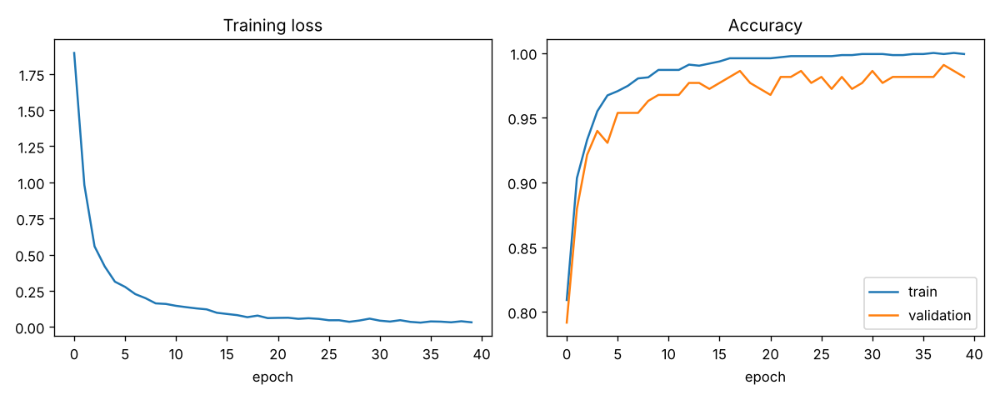

# Neural Network from Scratch (NumPy only)


A fully connected neural network built using **only NumPy**, with no PyTorch or TensorFlow. Every piece is written by hand: forward pass, backpropagation, softmax cross-entropy, dropout, and the SGD-with-momentum and Adam optimizers.

It reaches **~98% test accuracy** on handwritten digit classification.



## Why I built this

Frameworks hide the math. Writing backprop by hand forced me to understand exactly how gradients flow through each layer, why initialization matters, and what Adam actually does differently from SGD. The test suite checks every analytic gradient against a numerical one.

## Features

| Component | File | Notes |
|---|---|---|
| Dense layer | `nn/layers.py` | He initialization, matrix-form backprop |
| ReLU, Dropout | `nn/layers.py` | Inverted dropout (no rescaling at inference) |
| Softmax + cross-entropy | `nn/losses.py` | Numerically stable (max-subtraction trick) |
| SGD + momentum, Adam | `nn/optim.py` | Adam includes bias correction |
| Sequential model | `nn/model.py` | Save/load weights, predict |
| Gradient check tests | `tests/` | Analytic vs finite-difference gradients |

## Quickstart

```bash
git clone https://github.com/25poojam/numpy-neural-net.git
cd numpy-neural-net
pip install -r requirements.txt

python train.py --plot          # trains and saves training_curves.png
python -m pytest tests          # runs the gradient checks
```

Try different settings:

```bash
python train.py --optimizer sgd --lr 0.05 --epochs 60
python train.py --hidden 256 --dropout 0.3
```

## Results

| Setting | Test accuracy |
|---|---|
| 2 hidden layers × 128, Adam, dropout 0.2, 40 epochs | **98.1%** |

Data: scikit-learn's bundled digits dataset (1,797 8×8 grayscale images), split 68/12/20 into train/validation/test. scikit-learn is used **only** to load and split the data. The best checkpoint is chosen on validation, and the test set is evaluated exactly once.

## What I learned

- Backprop is just the chain rule applied in reverse. Each layer only needs to know its local derivative.
- Combining softmax and cross-entropy gives the clean gradient `probs - one_hot(y)`.
- Gradient checking catches subtle bugs that still let a model "kind of" train.
- Holding out a validation set for model selection keeps the test score honest.

## Possible extensions

- [ ] Batch normalization
- [ ] Convolutional layer (`im2col`)
- [ ] Train on full MNIST (28×28)
- [ ] Learning-rate schedules
